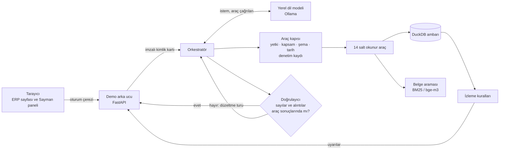

# Sayman

**Yapay Zekâ Destekli Finans Asistanı.** Şirketin kendi bilgisayarında çalışan yerel bir dil modeli, finans
sorularını yalnızca salt okunur araçlarla ve şirket belgeleriyle cevaplar. Cevaptaki her sayı ve alıntı, kullanıcıya
gösterilmeden önce o turun araç sonuçlarıyla karşılaştırılır; tutmayan cevap gösterilmez.

Entertech Yapay Zekâ Kariyer Atölyesi final projesi · Hazırlayan: Hüveyda Başyurtlu

> Bu bir prototiptir. Şirket verisi sentetiktir, kişiler kurgusaldır. Sayman yalnızca okur; para hareketi yapan bir
> aracı yoktur.

## Ne yapar

- **Türkçe finans sohbeti.** CFO ya da satış müdürü "Bankalarda toplam ne kadar nakit var?", "Vadesi geçmiş
  alacaklarımızın toplamı ne kadar?" gibi sorular sorar. Model 14 salt okunur araçtan uygun olanı çağırır: nakit
  pozisyonu, banka hareketleri, alacak yaşlandırma, geciken alacaklar, müşteri özeti, DSO, yaklaşan ödemeler, nakit
  akış tahmini, kur riski, döviz kuru, çek portföyü, POS tahsilatları, fatura arama ve belge arama.
- **Model hesaplamaz, doğrulanır.** Rakamlar araçlardan gelir. Bir doğrulayıcı, cevaptaki her sayının ve alıntının o
  turun araç sonuçlarında geçtiğine bakar. Geçmeyen taslak modele düzeltme için geri döner; yine olmazsa kullanıcı
  "doğrulanabilir bir cevap üretemedim" cevabını görür.
- **Yetki ve kapsam veri katmanında.** Her araç çağrısı tek bir kapıdan geçer: imzalı kimlik kartı, rolün araç izni,
  argüman şeması ve "bugün"den sonraki tarih kontrolü. Satış müdürleri yalnızca kendi müşterilerinin satırlarını
  içeren ayrı, salt okunur bir veritabanında çalışır. Reddedilenler dahil her çağrı, satırları birbirine zincirlenmiş
  bir denetim kaydına yazılır.
- **Belgelere dayalı cevap.** 81 sentetik sözleşme ve politika ile üç kanun (Çek Kanunu, Türk Borçlar Kanunu, Türk
  Ticaret Kanunu) aranır. Model alıntıyı madde kimliğiyle verir (`[POL-CEK#m2]`); alıntının o maddede gerçekten
  geçtiği kontrol edilir. Demoda alıntı, belgenin PDF'ini ilgili maddede açan bir bağlantıdır.
- **İzleme ve uyarılar.** Altı kural her gün yalnızca o güne kadar görünen kayıtlara bakar: nakit eşiği, olağandışı
  büyük çıkış, mükerrer ödeme, karşılıksız çek, faturası belli olmayan tahsilat birikimi ve büyük müşterinin
  gecikmesi. Uyarıyı kurallar verir; model yalnızca açıklar.
- **ERP'ye gömülü demo.** Kurgusal bir ERP'nin ("Defne ERP") ana sayfasında günlük nakit raporu, uyarılar ve Sayman
  sohbet paneli. "Zamanı ileri sar" düğmesi simülasyon saatini ilerletir; yeni günün uyarıları ve raporu gelir.
- **Ölçülmüş sonuçlar.** Her fazın kendi ölçümü var. Hedefler ve testler ölçümden önce yazılıp donduruldu
  (ön kayıt); sonuçlar `reports/` altında kayıtlı.

## Nasıl çalışır



- **Veri.** Gerçek bir iskelet (UCI satış faturaları, TCMB döviz kurları) üzerine tohumla birebir tekrarlanabilen
  sentetik bir Türk toptancı şirket kurulur. Tablolar tek bir DuckDB dosyasına yüklenir; metrikler SQL ile, verilen
  gün itibarıyla ve yalnızca o güne kadarki kayıtlarla hesaplanır.
- **Model.** Temel model `qwen3.5:9b` (Ollama). Faz 8'de Kaggle'da QLoRA ile ince ayar yapıldı (`sayman-ayarli`):
  amaç modeli veri ezberletmek değil, araç seçme, belgeye dayanma ve reddetme davranışlarını öğretmekti.
- **Arayüz.** Arka uç kimliği kendisi imzalar; imza anahtarı ve kimlik kartı tarayıcıya hiç gitmez. Bir cevap
  yalnızca soruyu soran oturuma gider; oturum kapanırsa model o soruyu bırakır.

## Sonuçlar

Bütün ölçümler 16 GB bellekli, ekran kartsız bir dizüstü bilgisayarda, çoğunlukla tek koşuyla yapıldı. Tablolar
`reports/faz11_rapor_guncel.md` dosyasından; ayrıntı ve yöntem [RAPOR.md](RAPOR.md) içinde.

**Saklanan set (250 soru):** Faz 7'deki kütüphane modeli ile Faz 8'in ince ayarlı modeli.

| Ölçü | Hedef | Kütüphane modeli | İnce ayarlı model |
| --- | --- | --- | --- |
| Yetkisiz sızıntı | 0 | 0 | 0 |
| Araç seçimi | ≥ 0,85 | 0,873 | 0,960 |
| Rakam doğruluğu | ≥ 0,75 | 0,820 | 0,907 |
| Doğrulanmış yanlış sayı | ≤ 0,03 | 0,113 | 0,067 |
| Belge cevabı | ≥ 0,70 | 0,325 | 0,875 |
| Geçerli belge alıntısı | ≥ 0,80 | 0,400 | 0,950 |
| Süre medyanı (sn) | ≤ 120 | 64,3 | 44,9 |

Belge ve araç davranışları, Faz 7'de saklanan set okunduktan sonra bilerek öğretildi; bu yüzden iyileşme yeni soru
türlerine genelleşme sayılmaz. Doğrulanmış yanlış sayı hedefi iki modelde de tutmadı.

**Diğer ölçümler**

| Ölçüm | Sonuç |
| --- | --- |
| Yetki kapısı (Faz 3) | 60 yetkisiz denemede 0 sızıntı |
| Belge arama, ayrılmış set, doğru madde ilk 5'te | anlam araması 1,000; kelime + anlam + sıralayıcı 0,981; yalnız kelime 0,769 |
| İzleme kuralları, üç tohum | en düşük geri çağırma 1,000; aylık yanlış alarm en çok 1,843 (sınır 2) |
| Genel Türkçe, Belebele (200 soru) | temel model %84, ince ayarlı %83,5 (p = 1,0000; unutma görülmedi) |
| Araç deneyi (Faz 9, 86 soru, aynı model) | elle tasarlanmış araçlar 65 doğru, OpenAPI'den otomatik üretilen araçlar 18 doğru |
| Üretim hızı | saniyede 5,11 token (ekran kartsız) |

Olayları ve izleme kurallarını, belgeleri ve belge sorularını aynı kişi yazdı; bu oranlar gerçek dünyadaki başarıyı
göstermez. Sınırlamaların tam listesi aşağıda.

## Gereksinimler

- **Windows 10 ya da 11.** Komutlar Windows yollarıyla yazıldı; `requirements.txt` Windows'a özel `pywin32` içerir.
- **Python 3.11** (paket `>=3.11,<3.12` ister).
- **[Ollama](https://ollama.com)** (0.40 ile denendi) ve `qwen3.5:9b` modeli (yaklaşık 6,6 GB).
- **16 GB bellek.** Model ekran kartı olmadan da çalışır; cevaplar bu durumda 30–80 saniye sürer.
- **İnternet yalnızca kurulumda:** UCI verisi (44 MB), kanun PDF'leri, Python paketleri, Ollama modelleri ve
  ölçümde kullanılan sıralayıcı modeli (2,2 GB). Demo çalışırken internete istek atmaz.
- İsteğe bağlı: belge PDF'leri için Edge ya da Chrome; anlam araması için `bge-m3` (1,2 GB).

## Kurulum

**1. Depoyu indirin ve Python ortamını kurun.**

```powershell
git clone https://github.com/Huveee/Sayman.git
cd Sayman
py -3.11 -m venv .venv
.venv\Scripts\python -I -m pip install -r requirements.txt
.venv\Scripts\python -I -m pip install -e . --no-deps --no-build-isolation
```

Son satır `src/sayman` paketini düzenlenebilir modda kurar; `scripts/` altındaki betikler paketi buradan bulur. Bu
adım atlanırsa betikler `ModuleNotFoundError: sayman` verir.

**2. Kimlik anahtarını üretin.**

```powershell
Copy-Item .env.example .env
.venv\Scripts\python -I scripts\phase03_generate_key.py
```

Betik kimlik kartlarını imzalayan anahtarı `.env` dosyasına yazar, ekrana yazmaz. `.env` git'e eklenmez.
`EVDS_API_KEY` yalnızca döviz kurlarını TCMB'den yeniden indirmek için gerekir; kurlar ve kalibrasyon bantları
`data/kaynak/` altında hazırdır. `KAGGLE_API_TOKEN` yalnızca Faz 8 eğitimi içindir.

**3. Sentetik şirket verisini ve ambarı kurun.**

```powershell
.venv\Scripts\python -I scripts\phase01_download_uci.py
.venv\Scripts\python -I scripts\phase01_generate_data.py
.venv\Scripts\python -I scripts\phase02_build_warehouse.py
```

İlk betik UCI Online Retail II verisini indirir. İkincisi şirketi üretir: tablolar `data/uretilen/`, simülasyon
saati `data/saat.json`. Üçüncüsü DuckDB ambarını kurar: `data/ambar/sayman.duckdb`. Üretim tohumla tekrarlanabilir:
aynı tohum aynı tabloları verir.

**4. Belge kütüphanesini kurun.**

```powershell
.venv\Scripts\python -I scripts\phase05_download_legislation.py
.venv\Scripts\python -I scripts\phase05_generate_documents.py
```

İlk betik üç kanunun PDF'ini mevzuat.gov.tr'den, ölçümde kullanılan sıralayıcı modeli de Hugging Face'ten indirir.
İkincisi şirket verisinden sözleşme ve politikaları üretir: `data/belge/belgeler.jsonl`.

**5. Modeli indirin.**

```powershell
ollama pull qwen3.5:9b
```

İnce ayarlı model (`sayman-ayarli`) depoda yok; model dosyaları git'e girmez. Kendiniz eğitmek için adımlar
[RAPOR.md](RAPOR.md) içindeki "Faz 8" bölümünde.

**İsteğe bağlı adımlar**

```powershell
ollama pull bge-m3
.venv\Scripts\python -I scripts\phase05_build_index.py
.venv\Scripts\python -I scripts\phase10_document_pdfs.py
```

İlk iki satır anlam araması için bütün maddeleri vektöre çevirir (bu bilgisayarda 26 dakika sürdü). Üçüncüsü belge
PDF'lerini Edge ya da Chrome ile üretir; bunlar olmadan cevaptaki alıntılar düz metin olarak görünür.

## Demoyu çalıştırma

```powershell
ollama serve
```

Ollama'yı demodan önce başlatın, sonra ayrı bir pencerede:

```powershell
.venv\Scripts\python -I scripts\phase10_demo.py baslat --model qwen3.5:9b --belge bm25
```

Tarayıcıda http://127.0.0.1:8010 adresini açıp bir kullanıcı seçin. Sohbet başlığındaki nokta "Hazır" olunca soru
sorun; model açılışta bugünün tarihiyle ısınır, bu birkaç dakika sürer.

| Kullanıcı | Rol | Gördüğü veri |
| --- | --- | --- |
| Selin Aydın | CFO | tüm şirket |
| Murat Kaya | Yurtiçi satış müdürü | yalnızca yurtiçi müşteriler |
| Deniz Arslan | İhracat satış müdürü | yalnızca yurt dışı müşteriler |

Kişiler kurgusaldır; demoda parola yoktur. Gerçek bir ERP'de oturumu ERP'nin kendi girişi açar.

| Seçenek | Varsayılan | Açıklama |
| --- | --- | --- |
| `--model` | `sayman-ayarli` | Ollama model adı. İnce ayarlı model yoksa `qwen3.5:9b`. |
| `--belge` | `anlam` | Belge araması: `anlam` (bge-m3, isteğe bağlı adımları ister), `bm25` (kelime araması, daha az bellek) ya da `yok`. |
| `--port` | `8010` | Sunucunun portu. |
| `--adim` | `7` | "Zamanı ileri sar" düğmesinin gün sayısı (1–31). |

Demo saati 1 Eylül 2026'dan başlar ve geri alınamaz; veri 12 Kasım 2026'da biter. Demo durumu `data/demo/`
klasöründedir. Saati ve uyarıları başa almak için demoyu kapatıp:

```powershell
.venv\Scripts\python -I scripts\phase10_demo.py sifirla
```

**Sorun giderme**

- *"Dil modeline şu an ulaşılamıyor."* Ollama kapalı. `ollama serve` ile başlatın, ardından demoyu yeniden başlatın
  ki model ısınsın.
- *Cevap çok geç geliyor.* Ekran kartı olmadan normaldir. "Zamanı ileri sar"dan sonra model yeni tarihle yeniden
  ısınır; nokta "Hazır" olana kadar bekleyin.
- *Alıntılar bağlantı değil.* Belge PDF'leri üretilmemiş; isteğe bağlı adımlardaki `phase10_document_pdfs.py`.

## Testler

```powershell
.venv\Scripts\python -I -m pytest -p no:cacheprovider
```

Yaklaşık 700 test, 6 dakika kadar sürer. Testler internete ve Ollama'ya gitmez; yerine betikli bir model kullanır ve
ölçüm betiklerinin kaydettiği dosyaları okur. Üretilmiş veriye ihtiyaç duyan testler, hangi betiğin çalıştırılması
gerektiğini yazarak atlanır.

- Tek dosya: `.venv\Scripts\python -I -m pytest -p no:cacheprovider tests\test_phase06_verifier.py`
- Model sözleşmesi (3 sn): `tests\test_model_contract.py`. İnce ayarlı model tam olarak gördüğü metinlerle
  eğitildi: sistem istemi, araç tanımları, araç sonuçlarının biçimi ve demo API'si. Bu test hepsini dondurur.

## Ölçümleri yeniden üretmek

Her fazın ölçüm betikleri ve ön kayıtları [RAPOR.md](RAPOR.md) içinde, faz faz anlatılır. Bütün ölçüm tablolarını
kayıtlı sonuçlardan, hiçbir model çalıştırmadan yeniden yazmak için:

```powershell
.venv\Scripts\python -I scripts\phase11_report.py
```

Çıktı `reports/faz11_rapor_guncel.md` dosyasıdır. Saklanan soru setleri bir kez çalıştırılır; ölçümden önce Ollama'da
başka model yüklü olmamalı ve başka iş çalışmamalıdır.

## Proje yapısı

| Klasör | İçerik |
| --- | --- |
| `src/sayman/data` | Sentetik şirket üreticisi ve simülasyon saati (Faz 1) |
| `src/sayman/warehouse` | DuckDB ambarı ve metrikler (Faz 2) |
| `src/sayman/tools` | 14 araç, MCP sunucusu, kimlik, yetki, kapsam ve denetim kaydı (Faz 3) |
| `src/sayman/monitoring` | İzleme kuralları ve zamanlayıcı (Faz 4) |
| `src/sayman/documents` | Belge kütüphanesi, arama ve alıntı kontrolü (Faz 5) |
| `src/sayman/assistant` | Orkestratör, doğrulayıcı ve Ollama modeli (Faz 6) |
| `src/sayman/evaluation` | Puanlayıcı, kâhin model, sistem parmak izi (Faz 7–8) |
| `src/sayman/training` | İnce ayar verisi ve GGUF özeti (Faz 8) |
| `src/sayman/experiment` | Sahte API ve otomatik üretilen araçlar (Faz 9) |
| `src/sayman/model_selection` | Model seçimi (Faz 0) |
| `src/sayman/demo` | Demo arka ucu ve ERP sayfası (Faz 10) |
| `scripts` | Her faz için `phaseNN_<iş>.py` betikleri |
| `tests` | Yazılım ve kabul testleri; `tests/support`: soru setleri ve puanlama yardımcıları; `tests/golden`: model sözleşmesi |
| `kaggle` | Faz 8'de Kaggle'da çalışan eğitim betikleri |
| `reports` | Kayıtlı ölçüm sonuçları |
| `data/kaynak` | Döviz kurları ve kalibrasyon bantları; `data/` altındaki diğer her şey üretilir ve git'e girmez |

## Belgeler

- [RAPOR.md](RAPOR.md): projenin faz faz raporu; her fazda ne yapıldı, nasıl ölçüldü, ne çıktı. Ön kayıtlar
  buradadır. Bu dosya 24 Kasım 2026'ya kadar `README.md` adını taşıyordu; kodda ve `reports/` altındaki kayıtlarda
  geçen "README Faz N" ifadeleri bu dosyanın ilgili bölümünü gösterir.
- [reports/faz11_rapor_guncel.md](reports/faz11_rapor_guncel.md): bütün ölçüm tabloları tek dosyada.

## Sınırlamalar

- Şirket verisi sentetiktir. Olayları ve izleme kurallarını, belgeleri ve belge sorularını aynı kişi yazdı; gerçek
  veri ve gerçek kullanıcı soruları daha zor olabilir.
- Ölçümler tek bilgisayarda ve çoğunlukla tek koşuyla yapıldı.
- Doğrulayıcıdan geçip gösterilen ama beklenen değeri taşımayan cevapların oranı (ince ayarlı modelde 0,067) 0,03
  hedefinin üstünde kaldı. Doğrulayıcı sayının araç sonuçlarında geçtiğine bakar; sayı başka bir kayda aitse ya da
  soruyu karşılamıyorsa bunu yakalayamaz.
- Cevapta yazıyla yazılan sayılar denetlenmez. Gerçek ama iddiayı desteklemeyen bir alıntı kontrolden geçer.
- Nakit akış tahmini yalnızca bilinen kalemleri içerir; maaş, SGK, vergi ve yeni satışlar dahil değildir. Demo bu
  notu tahmin cevaplarında gösterir.
- İnce ayarlı modelin iyileşmesi kısmen saklanan set okunduktan sonra öğretilen davranışlardan gelir.

## Veri kaynakları

- Chen, D. (2012). Online Retail II [Dataset]. UCI Machine Learning Repository.
  https://doi.org/10.24432/C5CG6D. Lisans: CC BY 4.0. Tarihler ileri kaydırılır, tutarlar TCMB kurlarıyla Türk
  lirasına çevrilir, müşteri adları sentetiktir.
- TCMB Elektronik Veri Dağıtım Sistemi (EVDS): döviz alış kurları ve Sektör Bilançoları alacak devir hızı.
- Atradius Payment Practices Barometer, Türkiye 2026: geç ödenen fatura payı ve gecikme dağılımı.
- Mevzuat Bilgi Sistemi (mevzuat.gov.tr): 5941 sayılı Çek Kanunu, 6098 sayılı Türk Borçlar Kanunu, 6102 sayılı Türk
  Ticaret Kanunu. Kanun metinleri 5846 sayılı Kanun'un 31. maddesi gereği telif kapsamı dışındadır.
- Modeller: qwen3.5:9b ve bge-m3 (Ollama kütüphanesi), BAAI/bge-reranker-v2-m3 (Hugging Face, Apache-2.0).

## Lisans

Depoda henüz bir lisans dosyası yok. Kullanılan veri setlerinin ve modellerin lisansları yukarıda listelenmiştir.
